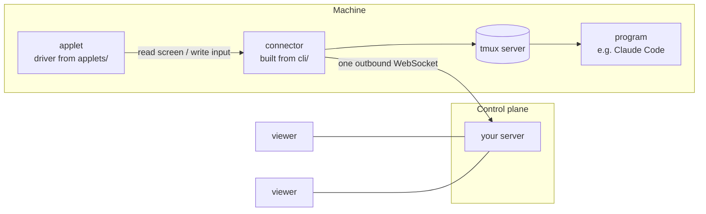

# micro-connector

micro-connector lets a control plane (a web service) run **terminal programs on machines it cannot
reach**, and lets people watch and type into them from anywhere. The machine dials out over one
WebSocket; nothing dials in. Each program runs in tmux on the machine, so it survives the connector
restarting, updating or crashing, and an **applet** (JavaScript the control plane supplies) drives it:
answering its dialogs, typing messages into it, and reporting what state it is in.

It is built for coding agents (Claude Code, Codex, pi and ACP agents are supported out of the box),
but nothing in it is specific to them or to any one product.



## What you get

- **Screens.** `session.create` starts a program in its own tmux session; the connector reports
  `session.ready` or `session.error`, and re-adopts running sessions after it restarts.
- **Viewers.** Every person watching gets their own tmux client, so each one opens fully drawn and
  catches up after falling behind without slowing anyone else. The terminal takes the smallest size
  among the viewers and tells each of them the size, so clients can centre it.
- **One typist at a time.** Input goes through a lease: a free terminal is taken by the first
  keystroke, held while the person keeps typing, and lapses after 3 s. The applet takes the same
  lease around a paste and its Enter, so a person and an agent driver never interleave keys.
- **Scrolling and copying through tmux.** The mouse wheel scrolls tmux's history (or reaches a
  full-screen program that asked for the mouse); `screen.capture` returns the text with history.
- **Drivers.** `applets/` holds the engine and one declaration per program: its startup dialogs,
  how to tell working from idle, and commands such as `compact` and `usage`. The engine types a
  message only once the program shows its prompt and reports whether it was submitted.
- **Lifecycle.** Install as a service (systemd, launchd, OpenRC, Windows), enrol with a code a person
  approves, update in place by downloading and re-executing; screens survive all of it.

## Repository

```
cli/       the Go library a connector is built from (see cli/README.md)
applets/   the driver engine and the program declarations, built to one JS file each
testbed/   a reference control plane and a minimal connector, and the end-to-end test that runs
           real programs (Claude Code, pi) through them against a mock model
docs/      protocol.md, the contract between a control plane and a connector
```

## Build a connector

```bash
go get github.com/micro-teams/micro-connector/cli@latest
```

```go
brand.Current = brand.Brand{Name: "yourthing", EnvPrefix: "YOURTHING", ConfigDir: "yourthing",
	RuntimeDir: "yourthing", ServiceName: "yourthing", EnrollBase: "/machine/enroll",
	BinaryBase: "/connector/latest"}

res, err := auth.Login(ctx, base, func(url string) { fmt.Println("approve at", url) })
tm, err := terminal.NewManager()
conn := ws.New(linkURL, res.Token, base)
mgr := screen.NewManager(ctx, conn, tm)
defer mgr.Detach() // leaves every screen running
conn.Run(ctx, mgr.Dispatch)
```

[`testbed/connector`](testbed/connector/main.go) is a complete connector in about 70 lines.
`service`, `update`, `config` and `apiauth` add the service install, self-update, a config file and
authenticated API calls; every package's file headers document its whole interface.

## Implement a control plane

[`docs/protocol.md`](docs/protocol.md) is the specification: enrolment, the messages, viewers, the
input lease and the rules a control plane must keep. [`testbed/server`](testbed/server/main.go) is a
reference control plane in a few hundred lines of Go that the end-to-end test runs against.

Serve the drivers from `applets/dist/<program>.js` as a screen's applet. Build them from the same
release as the connector you ship: a driver and the connector that runs it are tested as a pair.
They are also published as `@micro-teams/connector-applets` on GitHub Packages (needs
`@micro-teams:registry=https://npm.pkg.github.com` in `.npmrc`).

## Platforms

| | screens | service |
|---|---|---|
| Linux | yes (tmux, found via `<PREFIX>_TMUX`, `<config>/<brand>/bin/tmux`, then `PATH`) | systemd (user or system unit), OpenRC |
| macOS | yes | launchd (LaunchAgent or LaunchDaemon) |
| WSL2 | yes | systemd, after `service.EnsureSystemd` turns it on and WSL restarts |
| Windows | no (`terminal.ErrUnsupported`: no pty) | Windows service (administrator) |

All four are tested in CI.

## Versions

`VERSION` is the single source of the release number; `scripts/version.sh` reads it, checks that
every file agrees, sets a new one (`scripts/version.sh X.Y.Z`) and prints the release commands
(`--tags`). The Go library is released by the tag `cli/v<version>` (Go's rule for a module in a
subdirectory) and the drivers by `applets-v<version>`, together. A prerelease (`X.Y.Z-rc.N`) is
published under its own dist-tag, never `latest`; every merge to `main` publishes
`<version>-main.<run>` under `dev`.

The wire protocol has its own number (`protocol.Version`, now 2): it changes only when an older peer
could not survive the message set.

## Develop

```bash
(cd cli && go vet ./... && go test -race ./...)     # real tmux, isolated per test
(cd applets && npm ci && npm run typecheck && npm test)
bash testbed/e2e.sh fake                            # or npm:<claude version>, pi:<version>
```

Read [AGENTS.md](AGENTS.md) before changing anything; it holds the rules for this repository.

## License

MIT.
